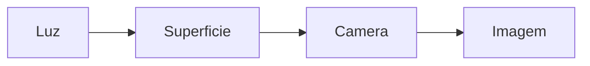
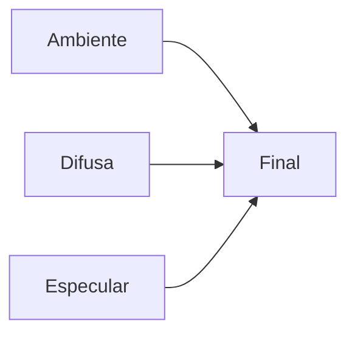
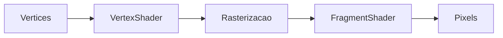

# Iluminação em Computação Gráfica

Objetivos de Aprendizagem:

- Compreender os fundamentos da iluminação.
- Aplicar modelos clássicos de iluminação.
- Relacionar teoria e implementação em OpenGL.
- Diferenciar iluminação, reflexão e sombreamento.
- Implementar iluminação em shaders GLSL.

---

## Introdução

A iluminação é responsável por grande parte do realismo visual em Computação Gráfica. Sem iluminação adequada, objetos tridimensionais tendem a parecer planos e artificiais.



## Fundamentos Físicos

### Luz

A luz é modelada como energia que incide sobre superfícies e é parcialmente refletida.

### Componentes

| Elemento | Descrição |
|-----------|-----------|
| Fonte de luz | Emite energia |
| Material | Define a reflexão |
| Superfície | Interage com a luz |
| Observador | Recebe a luz refletida |

## Vetores Utilizados

### Vetor Normal

$$
N=(N_x,N_y,N_z)
$$

### Vetor da Luz

$$
L=(L_x,L_y,L_z)
$$

### Vetor do Observador

$$
V=(V_x,V_y,V_z)
$$

Todos devem estar normalizados.

### Produto Escalar

$$
A\cdot B=A_xB_x+A_yB_y+A_zB_z
$$

$$
A\cdot B=|A||B|\cos\theta
$$

Quando normalizados:

$$
A\cdot B=\cos\theta
$$

### Exemplo - Vetores

$$
N=(0,0,1)
$$

$$
L=(0,0,1)
$$

$$
N\cdot L=1
$$

## Modelos de Reflexão

### Reflexão Ambiente

$$
I_a=k_aI_L
$$

### Reflexão Difusa (Lambert)

$$
I_d=k_dI_L\max(0,N\cdot L)
$$

### Reflexão Especular (Phong)

$$
I_s=k_sI_L\max(0,R\cdot V)^n
$$

## Modelo de Phong

$$
I=I_a+I_d+I_s
$$



### Exemplo Resolvido

Dados:

$$
k_a=0.2
$$

$$
k_d=0.7
$$

$$
k_s=0.5
$$

$$
I_L=100
$$

$$
N\cdot L=0.8
$$

$$
R\cdot V=0.9
$$

$$
n=16
$$

Resultado aproximado:

$$
I=85.26
$$

## Fontes de Luz

### Luz Direcional

Exemplo: Sol.

### Luz Pontual

Exemplo: Lâmpada.

### Spotlight

Exemplo: Holofote.

| Tipo | Posição | Direção |
|--------|--------|--------|
| Direcional | Não | Sim |
| Pontual | Sim | Não |
| Spotlight | Sim | Sim |

## Atenuação

$$
f(d)=\frac{1}{k_c+k_ld+k_qd^2}
$$

### Exemplo - Atenuação

$$
k_c=1,\quad k_l=0.1,\quad k_q=0.01,\quad d=10
$$

$$
f(d)=0.333
$$

## Materiais

### Foscos

Predomínio da reflexão difusa.

### Polidos

Predomínio da reflexão especular.

### Metálicos

Reflexão intensa e concentrada.

## Iluminação e Cor

A cor final normalmente é calculada componente a componente:

$$
Cor=(R,G,B)
$$

$$
CorFinal=CorObjeto\times CorLuz
$$

## Modelos de Sombreamento

### Flat Shading

Um cálculo por polígono.

### Gouraud Shading

Um cálculo por vértice.

### Phong Shading

Um cálculo por fragmento.

| Técnica | Qualidade | Custo |
|----------|-----------|--------|
| Flat | Baixa | Baixo |
| Gouraud | Média | Médio |
| Phong | Alta | Alto |

## Pipeline de Iluminação



## Implementação em OpenGL

### Uniforms Típicas

```glsl
uniform vec3 lightPos;
uniform vec3 lightColor;
uniform vec3 viewPos;
```

### Normais

```glsl
vec3 norm = normalize(Normal);
```

### Vetor da Luz

```glsl
vec3 lightDir = normalize(lightPos - FragPos);
```

## Exemplo GLSL Difuso

```glsl
float diff = max(dot(norm, lightDir), 0.0);
vec3 diffuse = diff * lightColor;
```

## Exemplo GLSL Especular

```glsl
vec3 reflectDir = reflect(-lightDir, norm);

float spec =
pow(max(dot(viewDir, reflectDir), 0.0),
    shininess);
```

## Múltiplas Luzes

A iluminação total é obtida pela soma das contribuições individuais:

$$
I=\sum_{i=1}^{n} I_i
$$

## Limitações dos Modelos Clássicos

- Não conservam energia.
- Não simulam materiais complexos.
- Não modelam reflexão global.
- Não simulam múltiplos espalhamentos.

## Introdução ao BRDF

A BRDF descreve matematicamente como a luz é refletida por uma superfície.

$$
f_r(\omega_i,\omega_o)
$$

Modelos PBR modernos utilizam BRDFs mais realistas.

## PBR (Physically Based Rendering)

Características:

- Conservação de energia.
- Rugosidade.
- Metallic.
- Fresnel.

## Boas Práticas

- Normalizar vetores.
- Utilizar normais corretas.
- Ajustar shininess adequadamente.
- Aplicar atenuação.

## Erros Comuns

| Erro | Consequência |
|--------|-------------|
| Normal invertida | Objeto escuro |
| Vetor não normalizado | Artefatos |
| Atenuação incorreta | Iluminação irreal |

## Resumo

A iluminação constitui um dos pilares da Computação Gráfica moderna. Os modelos clássicos, especialmente Lambert e Phong, permanecem fundamentais para a compreensão dos sistemas de renderização utilizados em OpenGL, motores de jogos e aplicações gráficas em tempo real.

## Exercícios

### Nível Básico

1. O que representa o vetor normal?
2. Qual é a finalidade da iluminação ambiente?
3. Explique a Lei de Lambert.

### Nível Intermediário

1. Calcule a iluminação difusa para:

$$
k_d=0.8,\quad I_L=100,\quad N\cdot L=0.6
$$

2. Calcule a iluminação ambiente para:

$$
k_a=0.25,\quad I_L=120
$$

### Nível Avançado

1. Compare Gouraud Shading e Phong Shading.
2. Explique as vantagens do PBR.
3. Implemente uma cena OpenGL contendo:
   - luz direcional;
   - luz pontual;
   - spotlight;
   - material brilhante;
   - material fosco.

## Resumo dos Tipos de Luz — LearnOpenTK

| Exemplo                          | Tipo de Luz                              | Atenuação | Texturas de Iluminação | Direcionalidade         |
|----------------------------------|------------------------------------------|-----------|-------------------------|--------------------------|
| 2-BasicLighting                  | Direcional simples                       | Não       | Não                     | Sim                      |
| 4-LightingMaps                   | Direcional com texturas                  | Não       | Sim                     | Sim                      |
| 5-LightCasters-DirectionalLights | Direcional avançada                      | Não       | Não                     | Sim                      |
| 5-LightCasters-PointLights       | Ponto (pontual)                          | Sim       | Não                     | Não (omnidirecional)     |
| 5-LightCasters-Spotlight         | Spotlight (cone)                         | Sim       | Não                     | Sim (cone)               |
| 6-MultipleLights                 | Múltiplas (direcional, ponto, spotlight) | Sim       | Sim                     | Vários tipos             |
| 0-Sem iluminação                 | Nenhuma                                  | –         | Não                     | Não se aplica            |

🔹 2-BasicLighting
• Tipo de luz: Direcional simples  
• Características:  
  • Simula uma fonte de luz distante, como o Sol  
  • A direção da luz é constante (não importa a posição do objeto)  
  • Não há atenuação (a luz não perde intensidade com a distância)  
  • Usa o modelo de iluminação de Phong (ambiente + difusa + especular)  

🔹 4-LightingMaps
• Tipo de luz: Direcional, mas com texturas  
• Características:  
  • Introduz texturas de difusa e especular  
  • Permite que diferentes partes de um objeto reflitam a luz de forma distinta  
  • A luz ainda é direcional  
  • Torna a iluminação mais realista usando mapas (texturas) para refletância  

🔹 5-LightCasters-DirectionalLights
 • Tipo de luz: Direcional (mais complexa)  
 • Características:  
   • Similar ao exemplo “2-BasicLighting”, mas com mais refinamento e estrutura  
   • Usa structs e uniform blocks para organizar propriedades da luz  
   • É a base para expandir para outros tipos de luzes  

🔹 5-LightCasters-PointLights
• Tipo de luz: Ponto (pontual)  
• Características:  
  • Emite luz em todas as direções a partir de um ponto no espaço, como uma lâmpada  
  • Inclui atenuação com base na distância (mais realista)  
  • A intensidade da luz decresce com a distância  

🔹 5-LightCasters-Spotlight
• Tipo de luz: Spot (foco direcional)  
• Características:  
  • Emite luz em um cone, como uma lanterna  
  • Tem direção e ângulo de corte (cutoff)  
  • Usa dois ângulos para criar uma transição suave (soft edges)  
  • cutOff (ângulo interno)  
  • outerCutOff (ângulo externo)  

🔹 6-MultipleLights
• Tipo de luz: Múltiplas (direcional + pontos + spot)  
• Características:  
  • Combina vários tipos de luzes ao mesmo tempo  
  • 1 luz direciona  
  • 4 luzes pontuai  
  • 1 holofote (spotlight)  
  • Demonstra como gerenciar diferentes luzes simultaneamente no shader  
  • Exige organização avançada de dados e loops nos shaders  

🔹 0-sem iluminação
• Características:  
  • Nenhuma fonte de luz está ativa  
  • Os objetos aparecem com cor constante ou textura sem interação com luz  
  • Útil para comparar efeitos de iluminação versus ausência de iluminação  

## Referências

- FOLEY, J. et al. Computer Graphics: Principles and Practice.
- HEARN, D.; BAKER, M. Computer Graphics.
- ANGEL, E.; SHREINER, D. Interactive Computer Graphics.
- SHIRLEY, P. Fundamentals of Computer Graphics.
