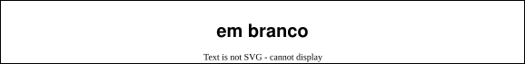

# Computação Gráfica - Unidade 4  

<!-- TODO: arrumar
Interface, Transformações 2D e Seleção, Programação orientada a eventos. Elementos de interface, Eventos e atributos de elementos de interface. Funções callback (teclado e mouse). Transformações de sistemas de coordenadas Transformações geométricas 2D, Algoritmos de seleção, Boundaring Box.  

Objetivo: demonstrar conhecimento no desenvolvimento de sistemas com interface gráfica com o usuário. Interpretar, especificar e desenvolver aplicações simples com transformações geométricas.  -->

## [Atividades - Aula](Atividade4.md "Atividades - Aula")  

## Rabiscos



## Material  

[cg-slides_u4.pdf](./cg-slides_u4.pdf "cg-slides_u4.pdf")  

[Iluminação em Computação Gráfica](./Iluminacao.md)  
[Texturas em Computação Gráfica](./Texturas.md)  

### OpenGL Enable/Disable

```CSharp

GL.Enable(EnableCap.DepthTest);    // Ativar teste de profundidade
GL.Enable(EnableCap.CullFace);     // Desenha os dois lados da face
GL.Disable(EnableCap.CullFace);
      
GL.FrontFace(FrontFaceDirection.Cw);
GL.CullFace(CullFaceMode.FrontAndBack);
```

### Objeto 3D

Exemplo para mostrar o uso de triângulos e objetos com grafo de cena e articulações:  
<https://sketchfab.com/3d-models/low-poly-bird-tucan-60763e236dae4a9695132a1699f68063>

## Nostalgia Gráfica

[TCC_Dalton.pdf](./TCC_Dalton.pdf)  

----------

## ⏭ [Unidade 1](../Unidade1/README.md "Unidade 1")  
