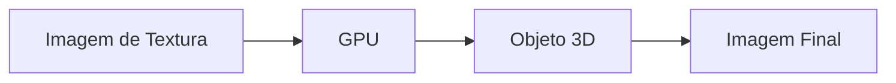
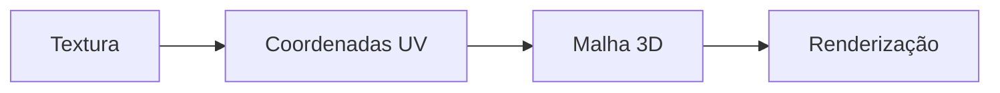
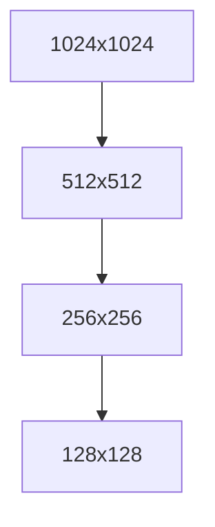

# Texturas em Computação Gráfica

Objetivos de Aprendizagem:

- Compreender o papel das texturas na Computação Gráfica.
- Entender o processo de mapeamento de texturas.
- Aplicar coordenadas UV em OpenGL.
- Diferenciar os principais tipos de texturas.
- Compreender filtragem, mipmapping e técnicas avançadas.

---

## Introdução

As texturas permitem adicionar detalhes visuais a objetos tridimensionais sem aumentar significativamente a complexidade geométrica.



## Conceitos Fundamentais

Uma textura é uma imagem aplicada sobre uma superfície para modificar sua aparência visual.

## Coordenadas UV

As coordenadas de textura são representadas por (u,v).

- u: direção horizontal
- v: direção vertical

0 <= u <= 1

0 <= v <= 1

## Mapeamento de Texturas

O processo de associar pontos da textura aos vértices de uma malha é denominado mapeamento de textura.



## Sistema UV

O conjunto das coordenadas é conhecido como mapa UV.

## Amostragem

A cor final é obtida pela consulta da textura em uma coordenada UV.

## Filtragem

### Nearest Neighbor

Seleciona o texel mais próximo.

### Bilinear

Interpola quatro texels.

### Trilinear

Combina mipmaps e filtragem bilinear.

## Texels

Texel significa Texture Element.

| Imagem | Textura |
|---------|---------|
| Pixel | Texel |

## Mipmapping

Mipmaps são versões reduzidas da textura.



## Wrap Modes

- Repeat
- Mirrored Repeat
- Clamp To Edge

## OpenGL

```cpp
glGenTextures(1, &texture);
glBindTexture(GL_TEXTURE_2D, texture);
```

## GLSL

```glsl
uniform sampler2D texture1;
vec4 color = texture(texture1, TexCoord);
```

## Tipos de Texturas

- Diffuse Map
- Specular Map
- Normal Map
- Height Map
- Emissive Map

## Normal Mapping

Permite simular detalhes sem aumentar a geometria.

## Bump Mapping

Modifica apenas o cálculo de iluminação.

## Parallax Mapping

Cria sensação de profundidade.

## Cube Maps

Utilizados para skyboxes, reflexões e refrações.

## Texturas Procedurais

Geradas matematicamente.

Exemplos:

- Madeira
- Mármore
- Nuvens

## Ruído de Perlin

Amplamente utilizado na geração procedural.

## Compressão

Formatos:

- DXT
- BC7
- ASTC

## Boas Práticas

- Utilizar mipmaps.
- Reduzir trocas de textura.
- Utilizar compressão.

## Erros Comuns

| Erro | Consequência |
|--------|-------------|
| UV incorreto | Distorções |
| Sem mipmaps | Aliasing |
| Texturas grandes | Consumo excessivo de memória |

## Exercícios

### Básico

1. O que é uma textura?
2. O que é UV Mapping?
3. O que é um texel?

### Intermediário

1. Explique Bilinear e Trilinear.
2. Explique a função dos mipmaps.

### Avançado

1. Compare Normal Mapping e Bump Mapping.
2. Explique a implementação de texturas em OpenGL.

## Referências

- Foley et al.
- Hearn e Baker.
- Angel e Shreiner.
- Shirley.
